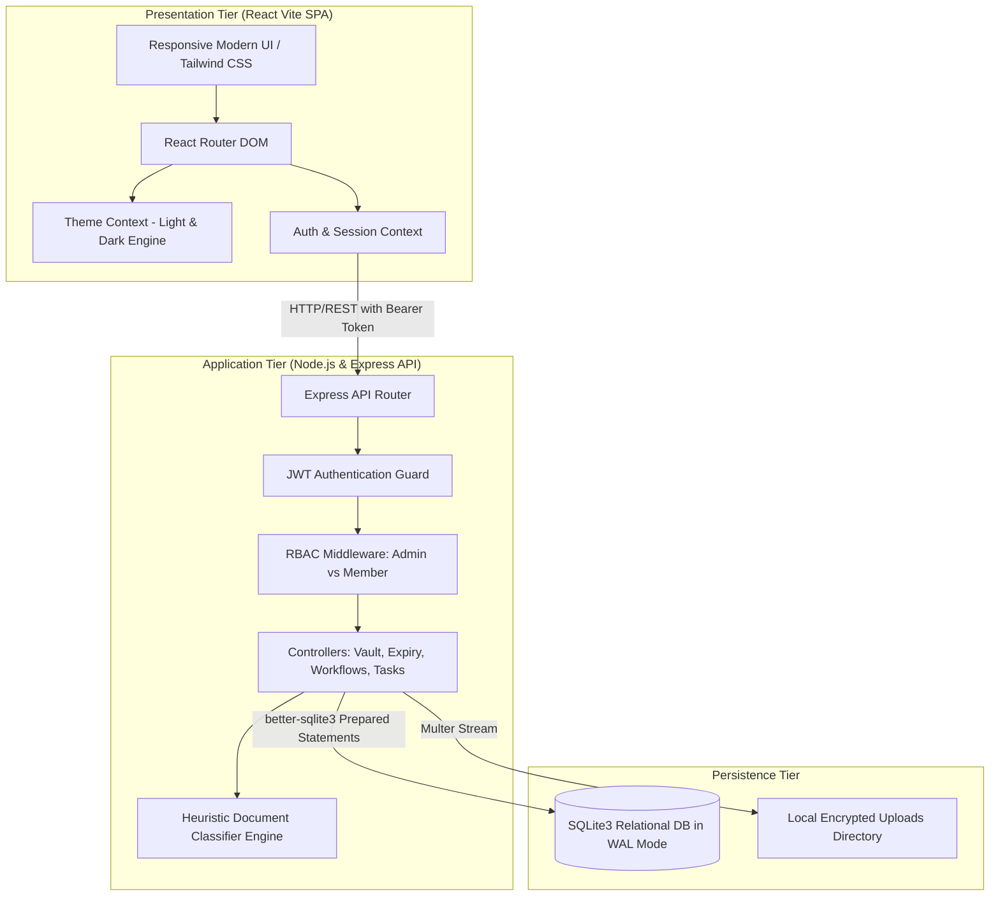
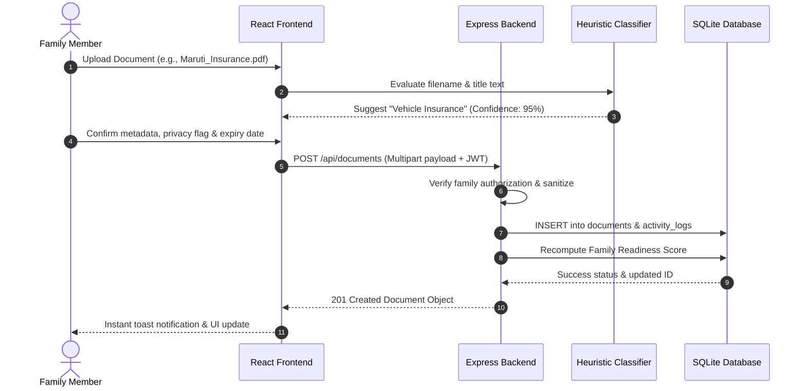
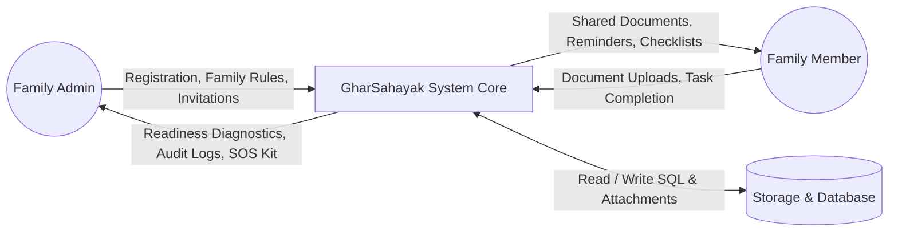
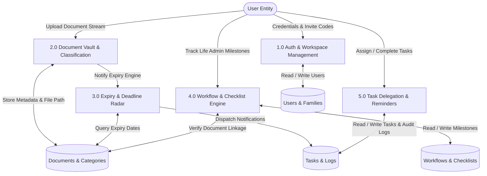

# MINOR PROJECT REPORT

## PROJECT TITLE:
### **GharSahayak – Smart Digital Life Administration Platform for Indian Families**

---

# CHAPTER 1: INTRODUCTION

## 1.1 Project Overview
Indian households manage substantial amounts of critical paperwork, identity documents, statutory filings, and insurance policies across multiple generations living under one roof. Traditionally, these records—such as Aadhaar cards, PAN cards, vehicle Registration Certificates (RC), health insurance policies, CBSE marksheets, property registry deeds, and bank fixed deposits—are stored haphazardly across physical steel cupboards, WhatsApp family chats, email threads, and disparate DigiLocker logins.

Consequently, critical renewal deadlines are frequently missed, resulting in lapsed medical policies, expired vehicle insurances carrying heavy traffic penalties, and delayed student scholarship or college admissions due to missing attestations. Furthermore, household administration disproportionately burdens a single family member (the de facto administrator) without collaborative delegation.

**GharSahayak** (meaning *Home Assistant*) is a secure, role-based, full-stack digital administration platform engineered specifically to resolve these challenges. It provides Indian families with a unified, private workspace featuring a Smart Document Vault with heuristic classification, proactive deadline and expiry radar tracking, pre-configured life-administrative workflows (such as college admissions and passport renewals), emergency medical and SOS quick-access kits, renewal cashflow forecasts, and one-click WhatsApp reminder coordination.

## 1.2 Objective
The core objectives of the GharSahayak project are:
1. **Centralization**: To eliminate fragmented record-keeping by establishing an isolated, encrypted digital family workspace accessible to all authorized members.
2. **Proactive Expiry Tracking**: To eliminate penalty fees and lapsed insurance policies by classifying document validity into visual tiers (Expired, 7-Day Critical, 30-Day, and 90-Day windows) backed by automated alerts.
3. **Streamlined Life Administration**: To simplify bureaucratic processes (e.g., PM Scholarships, B.Tech Counseling, Tatkaal Passport renewals) via pre-structured document checklists providing dynamic "Readiness Percentage" scoring.
4. **Collaborative Responsibility Sharing**: To enable family admins to assign administrative tasks and deadlines to spouses, siblings, or children, fostering shared household governance.
5. **Emergency Readiness**: To deliver an instant "Family Emergency Kit" granting zero-latency access to blood groups, cashless mediclaim policy numbers, TPA helplines, and primary physician contacts with one-click WhatsApp dispatch.
6. **Financial Renewal Liquidity Planning**: To forecast upcoming renewal expenditures over 30 and 90-day intervals to safeguard household cashflow.

## 1.3 Scope
The platform addresses the administrative lifecycle of modern nuclear and joint Indian families:
- **Workspace Isolation**: Multi-tenant architecture ensuring each family's records remain partitioned by unique family IDs and join invitation codes.
- **Role-Based Access Control (RBAC)**: Distinguishes between **Family Admin** (who manages membership, global settings, deletions, and workspace diagnostics) and **Family Members** (who access shared records, manage their own files, and complete assigned tasks).
- **Privacy Granularity**: Allows members to flag specific documents as "Private" (hidden from family members) or "Shared".
- **Cross-Platform Responsive UX**: Fully responsive on desktop monitors, tablets, and smartphones, supporting system-synced Light and Dark modes.
- **Out of Scope (Current Iteration)**: Integration with DigiLocker OAuth APIs and actual WhatsApp Business Cloud API gateways (currently simulated through client-side WhatsApp web schemes).

## 1.4 Tools Used
| Category | Tool / Software | Purpose / Utility |
| :--- | :--- | :--- |
| **Operating System** | macOS / POSIX Environment | Development and deployment environment |
| **Code Editor** | VS Code / Antigravity IDE | Source code authoring, linting, and refactoring |
| **Frontend Framework** | React.js 18.3 (Vite 6) | Component-based dynamic Single Page Application |
| **Styling & Design System** | Tailwind CSS 3.4 & Vanilla CSS | Modern responsive design with custom dark palette |
| **Typography** | Google Fonts (Plus Jakarta Sans & Inter) | Professional enterprise typography pairing |
| **Icons & Visuals** | Lucide-React & Recharts | Modern stroke icons and responsive analytics charts |
| **Backend Runtime** | Node.js (v20 LTS) & Express.js | High-throughput asynchronous RESTful API server |
| **Database Engine** | SQLite3 (`better-sqlite3`) in WAL Mode | High-performance, zero-config relational database |
| **Security & Auth** | JSON Web Tokens (JWT) & BcryptJS | Stateless token authorization & salted password hashing |
| **File Handling** | Multer | Multipart file uploads with mime-type validation |
| **API Testing** | cURL & Postman | REST API endpoint testing and validation |

---

# CHAPTER 2: SYSTEM DESIGN

## 2.1 System Architecture
GharSahayak follows a decoupled, three-tier client-server architectural pattern:
1. **Presentation Tier (Frontend SPA)**: Developed in React.js using Vite. Manages client-side routing via React Router DOM v6, application state using React Context APIs (`AuthContext`, `ThemeContext`, `ToastContext`), responsive layouts, and Recharts visualization.
2. **Application Tier (RESTful API Server)**: Built with Express.js running on Node.js. Enforces authentication middlewares, JWT validation, role-based permission verification, input sanitization, and request routing to controllers.
3. **Persistence Tier (Relational Storage)**: SQLite3 database operated in Write-Ahead Logging (WAL) mode for concurrency and low-latency disk I/O, coupled with a local filesystem storage for document attachments.

## 2.2 System Flow
The primary operational flow of GharSahayak unfolds across the following phases:
1. **Authentication & Workspace Onboarding**: The user registers with credentials. If they are the first family representative, they select "Create Family Workspace", generating an immutable Family Workspace and a 6-character Invite Code (e.g., `SINGH-786`). Subsequent family members join via the code.
2. **Document Ingestion & Auto-Classification**: Users upload documents via drag-and-drop. The heuristic classifier parses the title and filename against regex markers, automatically suggesting category, validity period, and confidence score.
3. **Audit Trail & Deadline Computation**: Once committed, the document validity date is registered into the Expiry Tracker engine, recalculating the family's overall "Readiness Score" (0–100) and scheduling reminder logs.
4. **Workflow Checklists & Tasks**: Administrative workflows cross-reference required documents against the vault, dynamically updating compliance percentages.

## 2.3 Data Flow Diagram

### Level 0 DFD (Context Diagram)
The context-level diagram illustrates the fundamental boundaries of the system, showing the external entities and the primary data exchanges.

### Level 1 DFD (Decomposed System Processes)
The Level 1 diagram breaks down the system into its five distinct processing subsystems:

## 2.4 Input Output Design

### Input Design
Input forms across GharSahayak are designed with input validation, type restrictions, and user assistance:
- **User Registration Form**: Captures full name, email address (regex-validated format), minimum 6-character password, and 10-digit Indian mobile number.
- **Document Upload Modal**: Accepts PDF, PNG, JPG, and WEBP formats with a 10MB limit. Fields include Title, Owner (family member dropdown), Category, Document Type, Expiry Date (HTML5 native date picker with validation), Locker Drawer Reference, and Privacy Flag (Shared vs. Private).
- **Task Creation Modal**: Collects task title, description, priority rating (Urgent, High, Medium, Low), assignee selector, and hard deadline.
- **Workflow Builder Modal**: Captures process title (e.g., Scholarship Application) and dynamic itemized document requirement rows.

### Output Design
Outputs are engineered for clarity, status contrast, and exportability:
- **Executive Family Dashboard**: Visual display of total records, urgent renewals, active tasks, circular Family Health Score (0–100), and Recharts category distribution.
- **Family Emergency Medical & ID Kit**: Tabular card view of all members' blood groups, masked Aadhaar numbers, PANs, Star Health mediclaim policy numbers, TPA helplines, and primary doctor contacts.
- **Family Document Vault Audit Manifest (CSV & Printable PDF)**: Exportable formal manifest formatted with headers: *Document Title, Owner, Category, Status, Expiry Date, File Name, Physical Locker Location*.
- **Personalized WhatsApp Dispatcher**: Generates pre-formatted WhatsApp text messages with emojis, urgency badges, and web direct links.

## 2.5 User Interface Design
The user interface follows modern SaaS design principles (inspired by Stripe and Linear):
- **Typography**: Dual Google Font system incorporating **Plus Jakarta Sans** (headings, metric counters) and **Inter** (body, inputs, data tables).
- **Responsive Layout**: Fluid sidebar navigation on large displays with an auto-collapsing mobile drawer menu on touchscreens.
- **Visual Feedback**: Micro-animations using Tailwind CSS, pulse indicators for urgent status badges, skeleton loading cards during network fetches, and toast notification alerts.
- **Light & Dark Theme Parity**: Universal theme switching utilizing `:where(.dark, .dark *)` CSS selector logic, ensuring high contrast between light canvas (`bg-slate-50`) and dark canvas (`bg-slate-950` with `slate-900` cards and `slate-800` borders).

---

# CHAPTER 3: IMPLEMENTATION

## 3.1 Implementation Approach
The platform was built following an iterative, modular development lifecycle:
1. **Database Schema Design**: Normalized relational architecture in SQLite with foreign key cascades connecting families, users, documents, workflows, and checklist items.
2. **API Controller & Service Layer**: Implemented asynchronous Express routes with centralized error-handling middlewares, parameterized SQL execution through `better-sqlite3`, and transactional operations for complex updates.
3. **Client-Side State Management**: Engineered independent React Context providers (`AuthContext`, `ThemeContext`, `ToastContext`) to maintain global application states without performance bottlenecks.
4. **Heuristic Document Auto-Classification**: Developed an integrated client/server heuristic keyword matcher referencing common Indian document nomenclatures to pre-populate metadata during file selection.
5. **Universal Theme Engine**: Implemented synchronous DOM attribute injection (`classList.add('dark')`, `setAttribute('data-theme', 'dark')`, and `colorScheme = 'dark'`) with an inline head script to prevent flash of unstyled content (FOUC).

## 3.2 Technologies Used
- **Frontend**:
  - `React.js (v18.3)`: Core view library utilizing functional components and hooks (`useState`, `useEffect`, `useContext`, `useRef`, `useMemo`).
  - `Vite (v6)`: Build tool and development server providing rapid Hot Module Replacement (HMR).
  - `Tailwind CSS (v3.4)`: Utility-first CSS framework configured with custom color tokens, font display mappings, and selector-based dark mode.
  - `Lucide-React`: Modern, clean SVG icon library.
  - `Recharts`: Declarative charting library for category distribution and expiry charts.
  - `React Router DOM (v6.28)`: Client-side routing with nested layout routes and private route guards.
- **Backend**:
  - `Node.js (v20 LTS)`: JavaScript server-side execution runtime.
  - `Express.js (v4.21)`: Minimalist HTTP web framework for REST API routing.
  - `Better-SQLite3`: Synchronous C++ binding for SQLite providing microsecond-level query execution.
  - `BcryptJS`: Password salting and hashing library (10 rounds).
  - `JSONWebToken (JWT)`: Stateless user authorization token generator.
  - `Multer`: File streaming middleware managing disk storage and unique timestamped file naming.
  - `CORS`: Cross-Origin Resource Sharing middleware.

---

# CHAPTER 4: TESTING AND OUTPUT

## 4.1 Objective of Testing
The primary goals of testing the GharSahayak platform were:
1. **Verification of Security & RBAC**: Confirm that unauthorized users cannot view documents flagged as "Private" and that non-admin members cannot delete family workspaces.
2. **Data Consistency**: Ensure foreign key constraints properly cascade on deletions (e.g., deleting a workflow removes associated checklist items).
3. **Calculation Accuracy**: Validate that the Family Readiness Score and Workflow Completion Percentages calculate accurately without division-by-zero anomalies.
4. **Cross-Browser & Theme Parity**: Verify that all screens, tables, and modal overlays render cleanly in both Light and Dark modes without text clipping or contrast loss.

## 4.2 Types of Testing

### 1. Unit Testing
Tested individual controller algorithms and utility functions:
- Password validation and bcrypt hash verification.
- Expiry date delta calculations (categorizing into `<0`, `0–7`, `8–30`, `31–90`, and `>90` days).
- Heuristic classifier keyword matching against standard strings (e.g., `marksheet` $\rightarrow$ Education).

### 2. Integration Testing
Tested end-to-end API workflows with mock payloads:
- User Registration $\rightarrow$ Family Workspace Creation $\rightarrow$ Document Upload $\rightarrow$ Dashboard Metric Update.
- Checklist Item Document Linkage $\rightarrow$ Recomputation of Workflow Readiness Score.
- Member Invitation via 6-character code $\rightarrow$ Access validation for shared family documents.

### 3. User Interface & Cross-Platform Testing
- Verified layout responsiveness across screen widths: 375px (Mobile), 768px (Tablet), 1024px (Laptop), and 1440px (Desktop).
- Validated keyboard accessibility (e.g., closing modals with `Escape`, opening Global Search with `Cmd+K` / `Ctrl+K`).
- Theme persistence verification across page reloads and browser tab sessions via `localStorage`.

### Test Cases Summary Table
| Test ID | Module | Test Description | Expected Result | Actual Result | Status |
| :--- | :--- | :--- | :--- | :--- | :--- |
| **TC-01** | Auth | Register new user with valid inputs | User created, JWT token generated | Token & user object returned | **PASS** |
| **TC-02** | Family | Join family with valid code `SINGH-786` | Linked to Singh Family workspace | Member linked successfully | **PASS** |
| **TC-03** | Vault | Upload PDF document with expiry date | Document stored, added to Expiry Tracker | Document visible in grid & radar | **PASS** |
| **TC-04** | Privacy | Member uploads document marked "Private" | Hidden from other family members | Document visible only to owner | **PASS** |
| **TC-05** | Workflow | Link document to checklist requirement | Requirement marked complete, score updates | Progress bar recalculated | **PASS** |
| **TC-06** | Theme | Click dark mode toggle in floating switcher | Root adds `dark`, palette shifts to slate-950 | Entire UI transitions smoothly | **PASS** |
| **TC-07** | Export | Export Vault manifest to CSV format | Browser downloads populated `.csv` file | Formatted CSV file downloaded | **PASS** |

## 4.3 Output Screens

### Screen 1: Public Landing Page & Demo Portal
- **Features**: Hero presentation with value proposition, animated feature pillar highlights (Smart Vault, Expiry Radar, Life Workflows, Family Tasks), security pledge, theme toggle, and one-click demo credentials.
- **Visuals**: Clean gradient typography, interactive dashboard preview mockup, and direct access links.

### Screen 2: Centralized Family Dashboard
- **Features**: Personalized time-sensitive greeting ("Good morning, Aditi"), 4 stat cards (Total Documents, Expirations, Tasks, Members), Urgent Action Required row with direct action buttons, circular Family Health & Readiness Score (84/100, Good) with interactive deduction explanation modal, and Recharts category distribution bar charts.

### Screen 3: Smart Document Vault (Grid & Table Views)
- **Features**: Multi-category filter badges (Identity, Tax, Vehicle, Insurance, Education, Finance, Property), owner dropdown filter, real-time search input, file upload drag-and-drop zone with auto-classification confidence pill, locker location indicators, and "Export Manifest" modal trigger.

### Screen 4: Deadlines & Expiry Tracker with Renewal Cashflow Forecast
- **Features**: KPI metrics strip (Expired, Next 7 Days, Next 30 Days, Tracked Total), Renewal Cost & Cashflow Tracker showing financial impact for upcoming 30 days (`₹36,500`) and 90 days (`₹58,700`), grouped timeline rows, custom alert configuration modal, and one-click WhatsApp reminder dispatcher.

### Screen 5: Administrative Workflows & Checklists ("Life Admin")
- **Features**: Itemized workflows for *PM Yashasvi Scholarship*, *B.Tech Engineering Admission*, and *Passport Renewal*. Displays dynamic progress bar (e.g., 67% Ready), missing requirement tags, document linkage modal, and requirement fulfillment checkboxes.

### Screen 6: Family Emergency SOS & Medical Kit
- **Features**: Critical modal listing all family members' blood groups, masked Aadhaar and PAN credentials, Star Health cashless mediclaim policy number (`P/161118/01/2026/004521`), TPA toll-free helpline, family physician contact (`Dr. Arvind Mehta`), one-click WhatsApp clipboard formatter, and printable emergency wallet slip.

---

# CHAPTER 5: CONCLUSION AND FUTURE WORK

## 5.1 Conclusion
The **GharSahayak** project delivers a comprehensive, full-stack digital solution addressing the administrative friction faced by Indian families. By integrating document storage, heuristic classification, deadline tracking, collaborative task delegation, and specialized life administration workflows into a single private workspace, the application reduces the risk of missed renewals, penalties, and lost records.

The system emphasizes security, performance, and user experience—employing high-contrast light and dark mode styling, responsive component architecture, and thoughtful household utilities such as the Family Emergency Kit and Renewal Cashflow Forecast. The project demonstrates the successful application of modern web technologies (React, Node.js, Express, SQLite, Tailwind CSS) in resolving real-world domestic administrative challenges.

## 5.2 Future Work
To expand upon the existing platform, future iterations will explore:
1. **Official DigiLocker API Integration**: Direct integration with the Government of India's DigiLocker gateway to enable automated retrieval and verification of Aadhaar, PAN, and vehicle RCs.
2. **Automated WhatsApp Business Bot**: Direct integration with the Meta WhatsApp Cloud API for bidirectional reminder notifications and document upload via chat.
3. **OCR & Automated Document Extraction**: Implementing Tesseract OCR or Google Document AI to parse uploaded PDF/image invoices, automatically extracting expiry dates, policy numbers, and premium amounts.
4. **Offline PWA & Mobile Apps**: Packaging the React frontend as an installable Progressive Web App (PWA) with offline biometric authentication (FaceID / Fingerprint) for enhanced physical security on mobile devices.
5. **Granular Financial Analytics**: Expanding the renewal cost engine to include automated bank mandate tracking and utility bill payment integrations (BBPS).

---

# CHAPTER 6: REFERENCES / GITHUB

## References
1. **React Documentation**: Facebook Open Source. *React – A JavaScript library for building user interfaces*. Available at: https://react.dev/
2. **Node.js Foundation**: *Node.js v20.x LTS Runtime Documentation*. Available at: https://nodejs.org/docs/
3. **Express.js Guide**: StrongLoop & IBM. *Express - Fast, unopinionated, minimalist web framework for Node.js*. Available at: https://expressjs.com/
4. **SQLite Architecture**: Hipp, D. R. *SQLite Write-Ahead Logging (WAL) Mode Specifications*. Available at: https://www.sqlite.org/wal.html
5. **Tailwind CSS System**: Wathan, A. et al. *Tailwind CSS Documentation (v3.4)*. Available at: https://tailwindcss.com/docs
6. **OWASP Foundation**: *OWASP Top 10 Web Application Security Risks – JWT and Authentication Guidelines*. Available at: https://owasp.org/
7. **Recharts API**: *Composable charting library built on React components*. Available at: https://recharts.org/

## GitHub Repository & Project Structure
- **Repository Title**: `GharSahayak - Smart Digital Life Administration Platform`
- **Root Directory Structure**:
  - `/backend`: Express REST API, SQLite database configuration, JWT auth middlewares, controllers, and database seed scripts.
  - `/frontend`: React SPA with Vite, Tailwind CSS configurations, responsive layouts, components, and contexts.
  - `/uploads`: Encrypted local file storage for document vault records.
